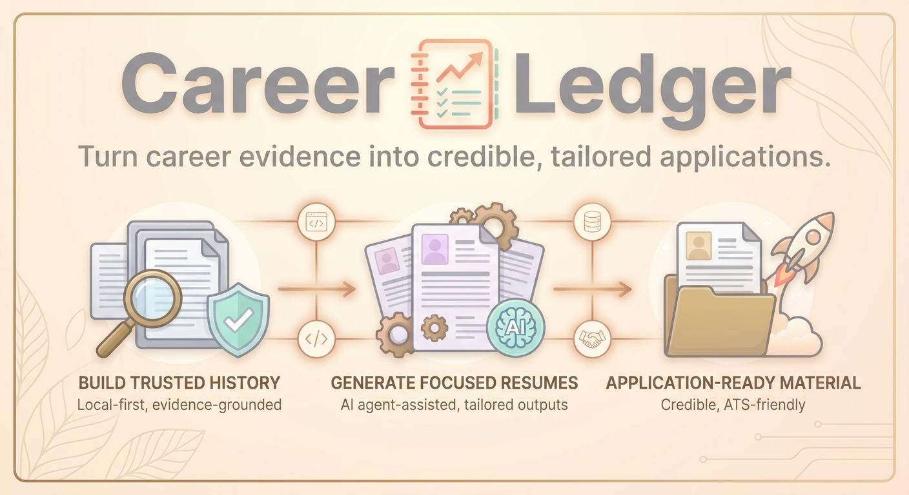
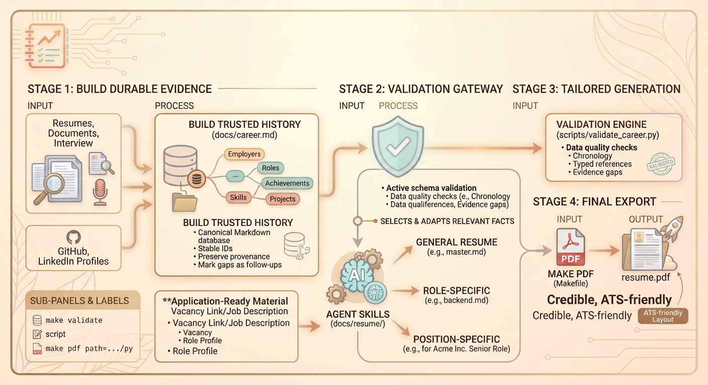

# Career Ledger



A local-first career knowledge system for building a trusted professional history, generating focused resumes, and keeping every claim grounded in evidence.

[Why Career Ledger?](#why-career-ledger) · [How it works](#how-it-works) · [Get started](#get-started) · [Commands](#commands)

## Your career, without the guesswork

Career details are usually scattered across old resumes, profiles, documents, and memory. Career Ledger brings them together in one structured source of truth, then helps an AI coding agent turn that evidence into application-ready material without inventing facts or quietly strengthening uncertain claims.

Use it to:

- Capture roles, achievements, skills, projects, education, and career breaks;
- Distinguish verified facts from estimates and unverified claims;
- Preserve evidence, ownership, disclosure limits, and unresolved gaps;
- Generate general, role-focused, or vacancy-specific resumes;
- Export clean, ATS-friendly Markdown resumes to PDF.

> [!IMPORTANT]
> Imported resumes are treated as source material, not proof. Career Ledger keeps uncertainty visible until you confirm the facts.

## Why Career Ledger?

### One dependable career record

Maintain a canonical Markdown database at `docs/career.md`. Stable semantic IDs connect roles, achievements, skills, projects, and follow-ups, so the history remains consistent as wording evolves.

### Evidence-aware by design

Every material achievement can record verification status, provenance, personal ownership, and disclosure restrictions. Honest qualitative results are preferred over invented metrics.

### Built for practical AI collaboration

Portable Agent Skills guide career intake and resume creation. Repository instructions keep supported coding agents aligned on the same workflows instead of relying on provider-specific copies.

### Quality gates included

The validator checks schema compatibility, required fields, dates, semantic IDs, typed references, controlled values, chronology, evidence gaps, and unresolved follow-ups before career data reaches a resume.

### Application-ready outputs

Resume variants live in `docs/resume/`. The PDF workflow renders them into `output/` using a compact, single-column layout suitable for applicant tracking systems.

## How it works



Career Ledger separates evidence from presentation. The career database stays neutral and reusable; each resume selects and adapts only the facts relevant to its audience.

## Get started

### 1. Fork the repository

The best way to use Career Ledger is to fork it and maintain your own copy. This gives you an independent career workspace while making it easy to pull in future improvements.

After forking the repository on GitHub, clone your fork:

```bash
git clone https://github.com/<your-github-username>/career-ledger.git
cd career-ledger
```

> [!CAUTION]
> Career records may contain personal information. Check your repository's visibility before committing real career data.

Python 3.10 or newer is required. Install [`uv`](https://docs.astral.sh/uv/) when you want PDF export; the core inspection and validation tools use the Python standard library.

### 2. Build your career ledger

Open the repository with an AI coding agent that supports repository instructions and Agent Skills, then ask:

```text
Help me write my career timeline.
```

Choose either an existing resume import or a guided interview. The workflow creates `docs/career.md` and records material gaps as explicit follow-ups.

### 3. Validate the evidence

```bash
python3 scripts/validate_career.py docs/career.md
```

Before generating a resume, require the minimum complete dataset:

```bash
python3 scripts/validate_career.py docs/career.md --require-complete
```

### 4. Generate a resume

Ask your agent to generate a resume. Career Ledger routes the request to one of three scopes:

1. General
2. For a particular position using a vacancy link or job description
3. For a specific role

Resume source files are written to `docs/resume/`.

### 5. Export to PDF

```bash
make pdf path=docs/resume/backend.md
```

The PDF is written to `output/backend.pdf`. Pass `--output` directly to `scripts/markdown_to_pdf.py` when you need a custom destination.

## What the ledger captures

- Identity and positioning facts
- Employers, roles, responsibilities, and achievements
- Education, certifications, projects, and professional activities
- Languages and career breaks
- Skills linked back to supporting evidence
- Data-quality follow-ups for missing or conflicting facts

The schema supports `Verified`, `Estimated`, and `Unverified` claims; contribution ownership from `Lead` through `Support`; and disclosure exceptions for interview-only or non-disclosable material.

## Commands

Inspect whether the career database is missing, empty, or populated:

```bash
python3 scripts/inspect_state.py docs/career.md
```

Validate the database:

```bash
make validate
```

Require roles and skills for downstream resume work:

```bash
make validate-complete
```

Run the test suite:

```bash
make test
```

Run tests and validation together after `docs/career.md` exists:

```bash
make check
```

Treat warnings as failures in stricter automation:

```bash
python3 scripts/validate_career.py docs/career.md --warnings-as-errors
```

## Designed for trustworthy applications

Career Ledger is for professionals who want the speed of AI-assisted writing without losing control of accuracy. It keeps the durable facts separate from the final pitch, making it easier to tailor applications while preserving a clear, auditable foundation.

Improvements are welcome. If you have an idea for a workflow, validator, portability enhancement, or documentation update, open an issue or submit a pull request to the main repository.

## License

Career Ledger is available under the [MIT License](LICENSE).
