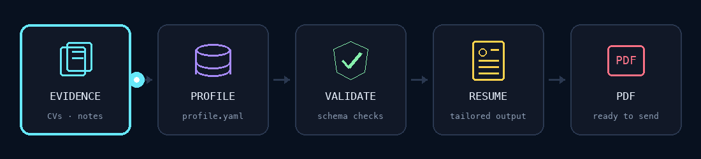
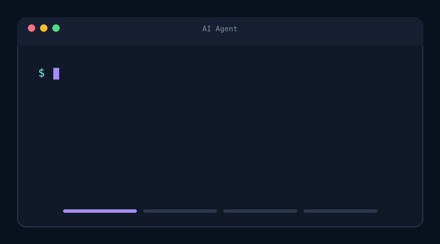

# Career Ledger

A local-first career profile and resume workflow for turning scattered professional history into a reusable source of truth—without inventing facts.



[Why Career Ledger?](#why-career-ledger) · [How it works?](#how-it-works) · [Getting started](#getting-started) · [Commands](#commands)

### Your career, without the guesswork

Career details drift across old resumes, profiles, documents, and memory. Career Ledger brings them into one structured profile, validates the data, and helps an AI coding agent produce focused resumes from the facts you approve.

- Capture roles, achievements, projects, skills, education, languages, and career breaks.
- Keep undisclosable education, employment, and skill usage out of application materials.
- Preserve unresolved gaps without turning them into confident claims.
- Generate general, role-focused, or vacancy-specific resumes.
- Export compact, single-column resumes to PDF.

> [!IMPORTANT]
> Imported resumes are source material, not proof. Career Ledger keeps uncertain details visible until you confirm or close them.

## Why Career Ledger?

### One profile, many applications

Your canonical profile lives in `data/profile.yaml`. Resume variants select and adapt relevant facts without rewriting your career history for every application.

### AI assistance with guardrails

Portable Agent Skills guide intake, clarification, auditing, updates, and resume generation. They preserve stable records, avoid stronger claims, and ask for missing facts one at a time.

### Validation built in

JSON Schema validation checks required fields, formats, IDs, controlled values, privacy flags, project links, and exact duplicates before profile data reaches a resume.

### Application-ready output

Generated resumes are saved under `docs/resume/`. The PDF workflow produces compact A4 documents in `output/`.

## How it works?

Career Ledger separates durable career facts from application-specific presentation:



### Use the career-ledger skill

The `career-ledger` skill is the main interface:

- `audit`: report errors, conflicts, privacy issues, unsupported claims, and gaps.
- `clarify`: inspect gaps and ask one factual question at a time.
- `generate`: create a resume through the resume workflow.
- `import`: reconcile a resume, CV, or other career evidence.
- `update`: change specific career facts.

Invoke `/career-ledger` without an argument to describe a profile task naturally.

### What the profile stores

- Identity, contact details, location, and languages
- Education and employment history
- Projects with concise situation, task, action, and result fields
- Reusable skill groups with tools, frameworks, and methods
- Privacy flags and material unresolved notes

The authoritative model is defined in `.agents/skills/career-ledger/references/schema.yaml`.

## Getting started

### 1. Fork and clone

```bash
git clone https://github.com/<your-github-username>/career-ledger.git
cd career-ledger
```

> [!CAUTION]
> Career records contain personal information. Confirm your repository visibility before committing real data.

Python 3.10 or newer and [`uv`](https://docs.astral.sh/uv/) are required for local commands.

### 2. Build your profile

Open the repository with an AI coding agent that supports Agent Skills, then import existing material:

```text
/career-ledger import
```

Or start a guided interview:

```text
/career-ledger clarify
```

### 3. Generate a resume

```text
/career-ledger generate
```

Choose a general resume, a specific role, or a particular vacancy. The result is saved under `docs/resume/`.

### 4. Export to PDF

```sh
make pdf path=docs/resume/CHANGE_ME.md
```

## Commands

```bash
make inspect          # Inspect profile state
make validate         # Validate the profile
make validate-strict  # Treat warnings as failures
make test             # Run tests
make check            # Run tests and validation
```

## Designed for trustworthy applications

Career Ledger gives professionals the speed of AI-assisted writing while keeping durable facts separate from the final pitch. Fork the repository, run `/career-ledger import`, and keep control of the record behind every application.

Contributions are welcome through issues and pull requests.

## License

Career Ledger is available under the [MIT License](LICENSE).
